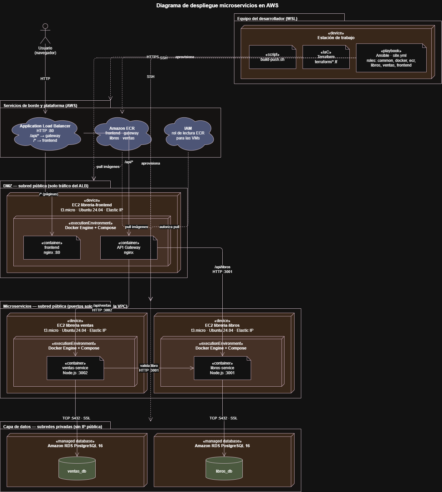
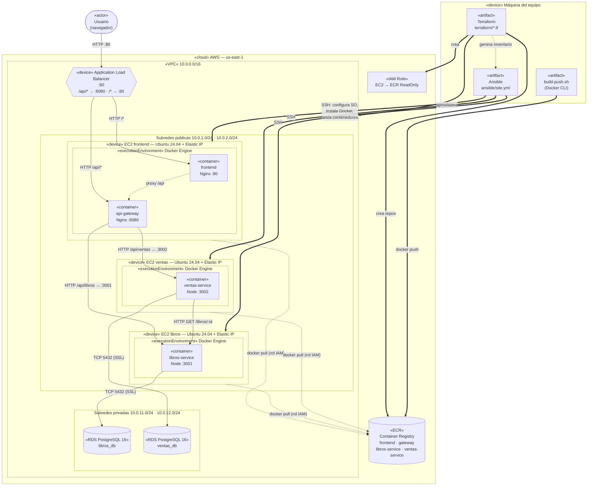
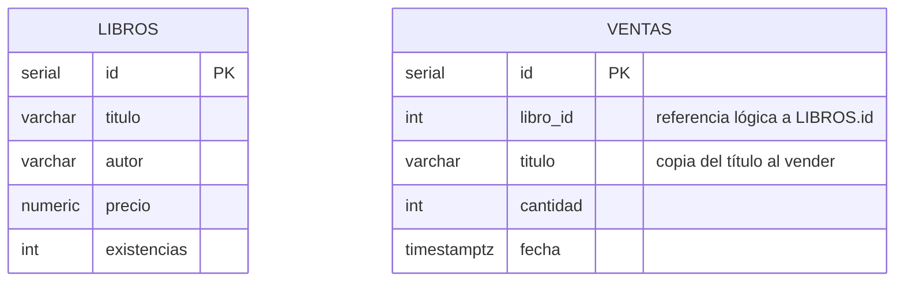

# Arquitectura — Librería AYD

## 1. Visión general

La plataforma sigue el patrón de **microservicios sobre una arquitectura por capas**:

| Capa | Componente | Tecnología | Dónde corre |
|------|-----------|------------|-------------|
| Presentación | Frontend (SPA) | HTML/CSS/JS servido por Nginx | VM `frontend` |
| Entrada | API Gateway | Nginx (reverse proxy) | VM `frontend` |
| Negocio | Microservicio de Libros | Node.js 20 + Express | VM `libros` |
| Negocio | Microservicio de Ventas | Node.js 20 + Express | VM `ventas` |
| Datos | `libros_db` | Amazon RDS PostgreSQL 16 | Subred privada |
| Datos | `ventas_db` | Amazon RDS PostgreSQL 16 | Subred privada |

Dentro de cada microservicio el código también está separado en capas:
`routes → controllers → services → repositories → db`. Ventas tiene además
`clients/` para consumir la API de Libros (valida que el libro exista y guarda su título).

Cada microservicio es dueño de **su propia base de datos** (patrón *database per service*):
ninguno lee la base del otro; Ventas pide datos de Libros por HTTP.

## 2. Diagrama de despliegue (UML)



El diagrama muestra los tres planos del sistema:

- **Equipo del desarrollador:** desde WSL, Terraform aprovisiona la infraestructura, `build-push.sh` publica las imágenes en ECR y Ansible configura las VMs por SSH.
- **AWS:** el ALB recibe el tráfico de los usuarios; las tres EC2 (frontend + gateway, ventas, libros) corren los contenedores y descargan las imágenes de ECR usando el rol IAM.
- **Datos:** dos instancias RDS PostgreSQL 16 en subredes privadas, una por microservicio, accesibles solo por TCP 5432 con SSL desde su servicio.

<details>
<summary>Versión en texto del diagrama (Mermaid)</summary>



</details>

### Elementos del diagrama

| Nodo | Recurso de AWS | Lo crea | Lo configura |
|------|----------------|---------|--------------|
| VPC, subredes, Internet Gateway, rutas | `aws_vpc`, `aws_subnet`, `aws_internet_gateway`, `aws_route_table` | Terraform | — |
| Balanceador | `aws_lb` + 2 target groups + regla `/api/*` | Terraform | — |
| 3 VMs con IP estática | `aws_instance` + `aws_eip` | Terraform | Ansible (`common`, `docker`, `ecr`) |
| Contenedores | imágenes en ECR | `build-push.sh` | Ansible (`libros`, `ventas`, `frontend`) |
| Bases de datos | `aws_db_instance` ×2 + `aws_db_subnet_group` | Terraform | Ansible (carga inicial del catálogo) |
| Registro de contenedores | `aws_ecr_repository` ×4 | Terraform | — |
| Permisos de las VMs | `aws_iam_role` + `aws_iam_instance_profile` | Terraform | — |
| Firewalls | `aws_security_group` ×6 | Terraform | — |

### Reglas de red (security groups)

| Grupo | Permite entrar | Desde |
|-------|---------------|-------|
| `alb` | 80 | Internet |
| `frontend` | 80, 8080 | solo el ALB |
| `libros` | 3001 | VM frontend (gateway) y VM ventas |
| `ventas` | 3002 | VM frontend (gateway) |
| `db-libros` | 5432 | solo VM libros |
| `db-ventas` | 5432 | solo VM ventas |
| frontend/libros/ventas | 22 | `admin_cidr` (para Ansible) |

Las bases de datos no tienen IP pública y viven en subredes sin salida a internet.

### Flujo de una petición

1. El navegador pide `http://<alb>/` → el ALB lo manda al contenedor `frontend` (:80).
2. El JavaScript llama a `/api/libros?q=...` → el ALB detecta `/api/*` y lo manda al `api-gateway` (:8080).
3. El gateway reescribe `/api/libros` → `/libros` y lo envía a `libros-service` por IP privada.
4. `libros-service` consulta `libros_db` en RDS (conexión SSL) y responde JSON.
5. Para registrar una venta, `ventas-service` pide a `libros-service` descontar las existencias
   (`PATCH /libros/:id/existencias`); si no alcanzan responde `409` y la venta no se guarda.
   Si se descontaron pero falla el guardado en `ventas_db`, las devuelve (compensación).

## 3. Contratos de las APIs

Todas las rutas públicas pasan por el API Gateway con el prefijo `/api`.
Las respuestas son JSON; los errores tienen la forma `{ "error": "mensaje" }`.

### Gateway

| Método | Ruta | Respuesta |
|--------|------|-----------|
| GET | `/health` | `200 ok` (texto) |
| * | `/api/libros...` | se reenvía a `libros-service` `/libros...` |
| * | `/api/ventas...` | se reenvía a `ventas-service` `/ventas...` |

### Microservicio de Libros (`:3001`)

Modelo `Libro`:

```json
{ "id": 1, "titulo": "Pedro Páramo", "autor": "Juan Rulfo", "precio": "95.00", "existencias": 12 }
```

| Método | Ruta | Cuerpo / parámetros | Respuesta |
|--------|------|---------------------|-----------|
| GET | `/libros` | Query opcional: `q` (título **o** autor), `titulo`, `autor`. Búsqueda parcial, sin distinguir mayúsculas ni tildes | `200` `Libro[]` ordenado por título |
| GET | `/libros/:id` | — | `200` `Libro` · `404` si no existe |
| POST | `/libros` | `{ titulo, autor, precio, existencias }` | `201` `Libro` · `400` si faltan datos o son negativos |
| PUT | `/libros/:id` | `{ titulo, autor, precio, existencias }` | `200` `Libro` · `400` · `404` |
| PATCH | `/libros/:id/existencias` | `{ delta }` entero ≠ 0 (negativo descuenta, positivo repone). Atómico: nunca deja existencias negativas | `200` `Libro` · `400` · `404` · `409` existencias insuficientes |
| GET | `/health` | — | `200 { "status": "ok" }` |

Ejemplos:

```bash
curl "http://<alb>/api/libros?q=garcia"
curl "http://<alb>/api/libros?autor=asturias"
curl -X POST http://<alb>/api/libros -H "Content-Type: application/json" \
     -d '{"titulo":"Aura","autor":"Carlos Fuentes","precio":80,"existencias":5}'
```

### Microservicio de Ventas (`:3002`)

Modelo `Venta`:

```json
{ "id": 1, "libro_id": 5, "titulo": "Pedro Páramo", "cantidad": 2, "fecha": "2026-10-21T16:30:00.000Z" }
```

| Método | Ruta | Cuerpo / parámetros | Respuesta |
|--------|------|---------------------|-----------|
| POST | `/ventas` | `{ libro_id, cantidad }` (cantidad entera > 0). Descuenta las existencias en Libros antes de guardar | `201` `Venta` · `400` datos inválidos · `404` libro no existe · `409` existencias insuficientes · `502` Libros no responde |
| GET | `/ventas` | — | `200` `Venta[]` (más reciente primero) |
| GET | `/ventas/ranking` | Query opcional `limite` (1–100, por defecto 10) | `200` `[{ libro_id, titulo, total_vendido }]` de mayor a menor |
| GET | `/health` | — | `200 { "status": "ok" }` |

Ejemplos:

```bash
curl -X POST http://<alb>/api/ventas -H "Content-Type: application/json" -d '{"libro_id":5,"cantidad":2}'
curl "http://<alb>/api/ventas/ranking?limite=5"
```

## 4. Modelo de persistencia



`libros` vive en la instancia RDS `libros_db` y `ventas` en `ventas_db`. Al estar en bases
distintas no hay llave foránea física: la integridad la valida `ventas-service` llamando a
`PATCH /libros/:id/existencias` antes de guardar (falla si el libro no existe o no hay suficientes). El título se copia en la venta para poder armar el ranking
sin consultar al otro servicio.

Las tablas las crea cada servicio al arrancar (`src/db.js`). El catálogo inicial lo carga Ansible
con [`ansible/roles/libros/files/seed.sql`](../ansible/roles/libros/files/seed.sql) solo si la tabla está vacía.

Escalabilidad de los datos: las instancias RDS tienen almacenamiento con autoescalado
(20 GB → 50 GB), cifrado en reposo, y se pueden cambiar de tamaño (`db_instance_class`) o
agregar réplicas de lectura sin tocar los servicios.
