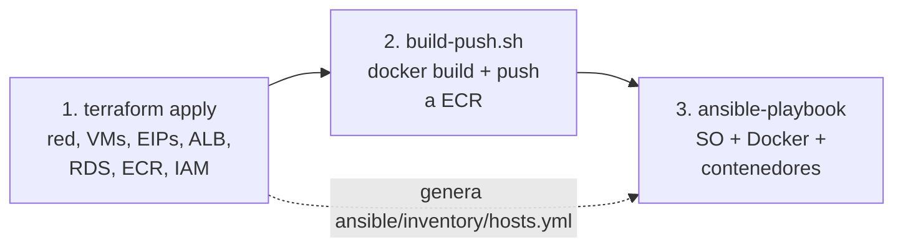

# Guía de despliegue en AWS

Todo el despliegue se hace con tres comandos: `terraform apply`, `build-push.sh` y `ansible-playbook`.



## Requisitos

Ansible no corre nativo en Windows, así que se usa **WSL (Ubuntu)** para todo.

```bash
# Dentro de WSL
sudo apt update && sudo apt install -y unzip python3-pip pipx git
pipx install --include-deps ansible
pipx ensurepath

# Terraform
wget -O- https://apt.releases.hashicorp.com/gpg | sudo gpg --dearmor -o /usr/share/keyrings/hashicorp.gpg
echo "deb [signed-by=/usr/share/keyrings/hashicorp.gpg] https://apt.releases.hashicorp.com $(lsb_release -cs) main" \
  | sudo tee /etc/apt/sources.list.d/hashicorp.list
sudo apt update && sudo apt install -y terraform

# AWS CLI v2
curl "https://awscli.amazonaws.com/awscli-exe-linux-x86_64.zip" -o awscliv2.zip
unzip awscliv2.zip && sudo ./aws/install
```

Docker: Docker Desktop con la integración de WSL activada (*Settings → Resources → WSL integration*).

> Clonar el repositorio **dentro** del sistema de archivos de WSL (`~/`), no en `/mnt/c/...`.
> En `/mnt/c` Ansible ignora `ansible.cfg` por permisos y SSH rechaza la llave privada.

### Credenciales de AWS

Crear un usuario IAM con acceso programático (para la práctica, `AdministratorAccess` basta) y:

```bash
aws configure          # Access key, Secret key, región us-east-1, formato json
aws sts get-caller-identity   # debe mostrar su cuenta
```

### Llave SSH

```bash
ssh-keygen -t ed25519 -f ~/.ssh/libreria-ayd -N ""
```

## 1. Infraestructura con Terraform

```bash
cd terraform
cp terraform.tfvars.example terraform.tfvars
# opcional: poner su IP en admin_cidr →  curl -s ifconfig.me
terraform init
terraform plan
terraform apply          # ~10 min, RDS es lo más lento
```

Al terminar muestra:

```
url_aplicacion = "http://libreria-ayd-alb-XXXX.us-east-1.elb.amazonaws.com"
ips_publicas   = { frontend = "...", libros = "...", ventas = "..." }
ecr_registry   = "123456789012.dkr.ecr.us-east-1.amazonaws.com"
```

y escribe el inventario `ansible/inventory/hosts.yml` (ignorado por git porque lleva las contraseñas de RDS).

## 2. Imágenes a ECR

Desde la raíz del repo:

```bash
chmod +x scripts/build-push.sh
./scripts/build-push.sh
```

Construye `frontend`, `gateway`, `libros-service` y `ventas-service` para `linux/amd64`
y las sube a ECR con los tags `latest` y el hash corto del commit.

## 3. Configuración y despliegue con Ansible

```bash
cd ansible
ansible all -i inventory/hosts.yml -m ping       # prueba de conexión
ansible-playbook -i inventory/hosts.yml site.yml
```

Qué hace el playbook ([`ansible/site.yml`](../ansible/site.yml)):

| Rol | Hosts | Tareas |
|-----|-------|--------|
| `common` | todos | Espera cloud-init, hostname, zona horaria `America/Guatemala`, actualiza paquetes, actualizaciones de seguridad automáticas, swap de 1 GB, parámetros de kernel, SSH solo con llave y sin root |
| `docker` | todos | Repositorio oficial de Docker, Docker Engine + Compose, rotación de logs, usuario `ubuntu` en grupo `docker` |
| `ecr` | todos | `amazon-ecr-credential-helper` para que `docker pull` use el rol IAM de la VM |
| `libros` | libros | `.env` con credenciales de RDS (permisos 600), `docker compose up`, espera `/health`, carga el catálogo inicial |
| `ventas` | ventas | `.env` con RDS y la IP privada de libros, `docker compose up`, espera `/health` |
| `frontend` | frontend | Gateway (:8080) y frontend (:80) en una red Docker propia, verifica que el gateway llegue a libros |

Los contenedores corren con `restart: unless-stopped`, `no-new-privileges`, límite de memoria y healthcheck.

El playbook es idempotente: se puede volver a correr cuando se quiera.

## 4. Verificar

```bash
URL=$(terraform -chdir=terraform output -raw url_aplicacion)
curl $URL/api/libros
curl $URL/api/ventas/ranking
```

Abrir la URL en el navegador. Los *target groups* tardan ~30 s en marcarse *healthy* después del playbook.

## Actualizar una versión

```bash
./scripts/build-push.sh
cd ansible && ansible-playbook -i inventory/hosts.yml site.yml --limit libros   # o el host que cambió
```

Para desplegar un tag específico: `terraform apply -var image_tag=<hash>` (regenera el inventario) y correr el playbook.

## Problemas comunes

| Síntoma | Causa / solución |
|---------|------------------|
| `UNREACHABLE` en Ansible | `admin_cidr` no incluye su IP actual, o la llave tiene permisos abiertos (`chmod 600 ~/.ssh/libreria-ayd`) |
| `FreeTierRestrictionError` al crear RDS | Dejar `db_backup_retention = 0` |
| `no basic auth credentials` en `docker pull` | El rol `ecr` no corrió, o no se subieron las imágenes (`build-push.sh`) |
| `no pg_hba.conf entry ... no encryption` | Falta `DB_SSL=true` en el `.env` del servicio |
| 502 en `/api/...` | Revisar `docker logs libros-service` en la VM (`ssh -i ~/.ssh/libreria-ayd ubuntu@<ip>`) |

## Destruir todo

Para no generar costos después de la calificación:

```bash
cd terraform && terraform destroy
```
