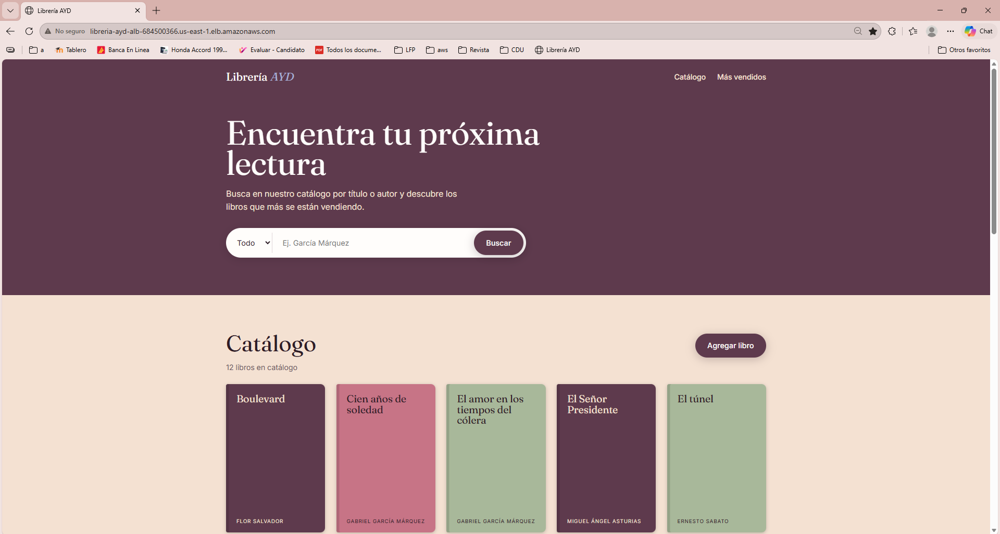
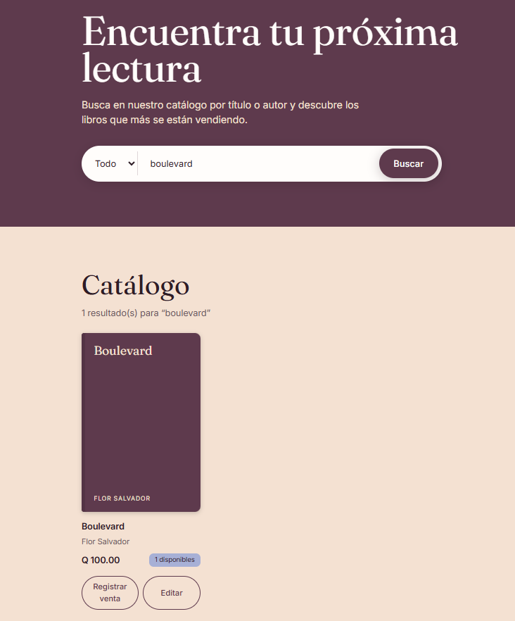
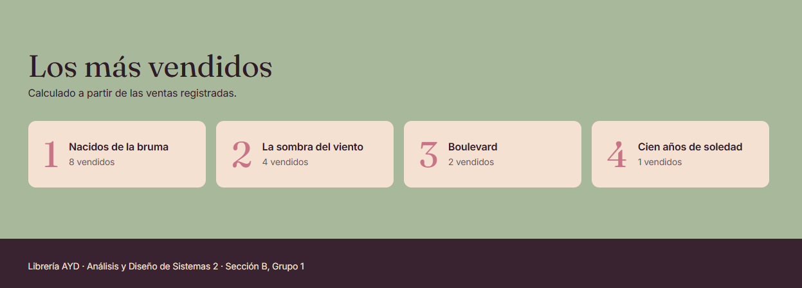
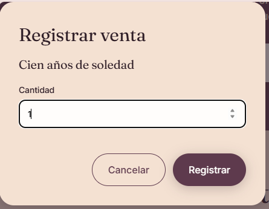
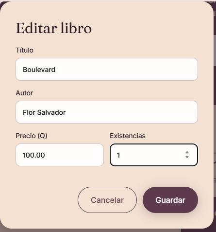
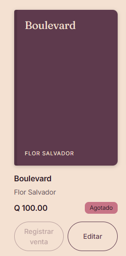

# Manual de usuario — Librería AYD

Este manual explica cómo usar la página web de la Librería AYD, tanto para clientes como
para el personal de la librería.

## Acceso

Abra en su navegador la dirección que le compartió el equipo (por ejemplo
`http://libreria-ayd-alb-XXXX.us-east-1.elb.amazonaws.com`). No necesita usuario ni contraseña.

La página tiene tres partes, de arriba hacia abajo:

1. **Buscador** — para encontrar libros.
2. **Catálogo** — todos los libros disponibles.
3. **Los más vendidos** — el ranking de ventas.

El menú superior tiene los enlaces **Catálogo** y **Más vendidos** para saltar directo a cada sección.

## Ver el catálogo

En la sección **Catálogo** cada libro aparece como una tarjeta con:

- **Título** y **autor**.
- **Precio** en quetzales (por ejemplo, `Q 150.00`).
- **Existencias**: cuántas copias hay (`10 disponibles`). Si no quedan, dice **Agotado**.

Arriba de las tarjetas se muestra cuántos libros hay en el catálogo.

Debajo de cada tarjeta están los botones **Registrar venta** y **Editar**, que se explican más adelante.

## Buscar y filtrar libros

1. En el buscador, elija en la lista desplegable **qué** quiere buscar:
   - **Todo**: busca en el título y en el autor a la vez.
   - **Título**: solo en el nombre del libro.
   - **Autor**: solo en el nombre del autor.
2. Escriba una parte del texto, por ejemplo `garcia` o `soledad`.
3. Los resultados se actualizan solos mientras escribe. También puede presionar **Buscar**.

Consejos:

- No importa usar mayúsculas o tildes: `garcia marquez` encuentra *Gabriel García Márquez*.
- Basta con una parte de la palabra: `rul` encuentra a *Juan Rulfo*.
- Si no hay coincidencias verá el mensaje *“No hay libros que coincidan con …”*.
- Para volver a ver todo el catálogo, borre el texto del buscador.

## Ver los libros más vendidos

Baje a la sección **Los más vendidos** (o use el enlace del menú). Ahí aparecen hasta
5 libros con más copias vendidas, de mayor a menor, con el total de unidades vendidas de cada uno.

Si todavía no se ha registrado ninguna venta verá *“Aún no hay ventas registradas.”*

## Registrar una venta (personal de la librería)

1. Busque el libro en el catálogo.
2. Presione **Registrar venta** en su tarjeta.
3. En la ventana que se abre, escriba la **cantidad** de copias vendidas (mínimo 1).
4. Presione **Registrar**. Para salir sin guardar, presione **Cancelar**.

Al registrar, las existencias del libro bajan y el ranking de **Los más vendidos** se actualiza al instante.
No se puede vender más copias de las que hay: si lo intenta verá *“Existencias insuficientes: solo hay N”*.
Si algo falla (por ejemplo, la cantidad no es válida) el mensaje de error aparece dentro de la misma ventana.

## Agregar un libro (personal de la librería)

1. En la sección **Catálogo**, presione **Agregar libro**.
2. Llene todos los campos:
   - **Título** (hasta 200 caracteres)
   - **Autor** (hasta 150 caracteres)
   - **Precio (Q)** — puede tener centavos, no puede ser negativo
   - **Existencias** — número entero, 0 o más
3. Presione **Guardar**. El libro aparece de inmediato en el catálogo.

## Editar un libro o agregar existencias (personal de la librería)

Use esta opción cuando llegue mercadería nueva, cambie un precio o haya que corregir un dato.

1. Busque el libro en el catálogo y presione **Editar** en su tarjeta.
2. Se abre la ventana **Editar libro** con los datos actuales ya llenos.
3. Cambie lo que necesite. Para **reabastecer**, escriba en **Existencias** el total de copias
   que hay ahora (por ejemplo, si había 2 y llegaron 10, escriba `12`).
4. Presione **Guardar**. La tarjeta se actualiza de inmediato.

Cuando un libro está **Agotado**, el botón **Registrar venta** aparece desactivado hasta que se le agreguen existencias.

## Mensajes que puede ver

| Mensaje | Qué significa | Qué hacer |
|---------|---------------|-----------|
| *Cargando catálogo…* | La página está pidiendo los libros | Esperar un momento |
| *No se pudo cargar el catálogo* | El servicio de libros no respondió | Recargar la página; si sigue, avisar al equipo técnico |
| *No se pudo cargar el ranking* | El servicio de ventas no respondió | Recargar la página |
| *El libro no existe* | El libro fue eliminado o el catálogo cambió | Recargar la página e intentar de nuevo |
| *libro_id y cantidad (entero > 0) son obligatorios* | La cantidad está vacía, es 0 o tiene decimales | Escribir un número entero de 1 o más |
| *Existencias insuficientes: solo hay N* | Quiere vender más copias de las disponibles | Bajar la cantidad a N o menos |
